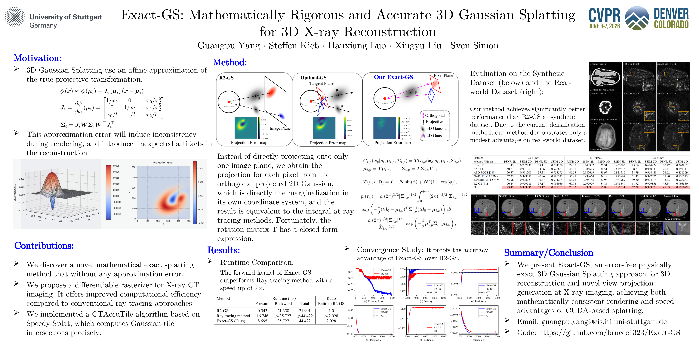

&nbsp;

<div align="center">


<h2>  <a href="https://openaccess.thecvf.com/content/CVPR2026/html/Yang_Exact-GS_Mathematically_Rigorous_and_Accurate_3D_Gaussian_Splatting_for_3D_CVPR_2026_paper.html"> Exact-GS: Mathematically Rigorous and Accurate 3D Gaussian Splatting for 3D X-ray Reconstruction </a>    </h2>


</div>

&nbsp;

## Introduction


This is the official implementation of our CVPR 2026 paper.

Paper: [Exact-GS](https://openaccess.thecvf.com/content/CVPR2026/html/Yang_Exact-GS_Mathematically_Rigorous_and_Accurate_3D_Gaussian_Splatting_for_3D_CVPR_2026_paper.html).

Presentation: [Video presentation](https://www.youtube.com/watch?v=MsCFB3z-cJU).


## 1. Installation

We recommend using pip to do the installation.

```sh
pip install torch==2.1.2+cu118 torchvision==0.16.2+cu118 --extra-index-url https://download.pytorch.org/whl/cu118
pip install -r requirements.txt
pip install -e exact_gs/submodules/simple-knn
pip install -e exact_gs/submodules/exact-gaussian-rasterization
pip install -e exact_gs/submodules/xray-gaussian-rasterization-voxelization

# Install TIGRE for data generation and initialization
pip install TIGRE-2.3/Python --no-build-isolation
```


## 2. Dataset

coming soon...

## 3. Running

3.1 Training

Use `train.py` to train Gaussians. 

```sh
# Training
python train.py 
--method <method name: 'R2'  or 'Exact_GS'>  
--source_path <path to data>    
--test_iterations <Iteration at which the training script evaluate rendering and reconstruction performance over test set>
--iterations <Number of total iterations to train>
--lambda_dssim <Weight of SSIM loss>
--densify_from_iter <Iteration where densification starts>
--save_iterations <Iteration at which the model will be saved>


# Example
python train.py --method=R2 --source_path=data/0_convergency_cone_5  --iterations=10000 --lambda_dssim=0
python train.py --method=Exact_GS --source_path=data/0_convergency_cone_5 --iterations=10000 --lambda_dssim=0

python train.py --method=R2 --source_path=data/3_pepper_50 --iterations=30000 --lambda_dssim=0.25
python train.py --method=Exact_GS --source_path=data/3_pepper_50 --iterations=30000  --lambda_dssim=0.25
```


3.2 Evaluation

We store evaluation results into the tensorboard events during training. You can also perform more detailed evaluation with `test.py`.

```sh
python test.py 
--method <method name: 'R2'  or 'Exact_GS'>  
--source_path <path to data>  
--model_path <path to model>  

# Example
python test.py --method=R2 --source_path=data/0_convergency_cone_5 --model_path=data/0_convergency_cone_5/output
python test.py --method=Exact_GS --source_path=data/0_convergency_cone_5 --model_path=data/0_convergency_cone_5/output

python test.py --method=R2 --source_path=data/3_pepper_50 --model_path=data/3_pepper_50/output
python test.py --method=Exact_GS --source_path=data/3_pepper_50 --model_path=data/3_pepper_50/output
```

## 4. Acknowledgement, license and citation

Our code is adapted from [Gaussian Splatting](https://github.com/graphdeco-inria/gaussian-splatting), [r2_gaussian](https://github.com/Ruyi-Zha/r2_gaussian/tree/main), [Speedy-Splat](https://github.com/j-alex-hanson/speedy-splat). Thanks to everyone who contributed code. This project is under the license of [Gaussian Splatting](https://github.com/graphdeco-inria/gaussian-splatting).

## 5. BibTeX

```
@InProceedings{Yang_2026_CVPR,
    author    = {Yang, Guangpu and Kie{\ss}, Steffen and Luo, Hanxiang and Liu, Xingyu and Simon, Sven},
    title     = {Exact-GS: Mathematically Rigorous and Accurate 3D Gaussian Splatting for 3D X-ray Reconstruction},
    booktitle = {Proceedings of the IEEE/CVF Conference on Computer Vision and Pattern Recognition (CVPR)},
    month     = {June},
    year      = {2026},
    pages     = {4902-4911}
}
```
